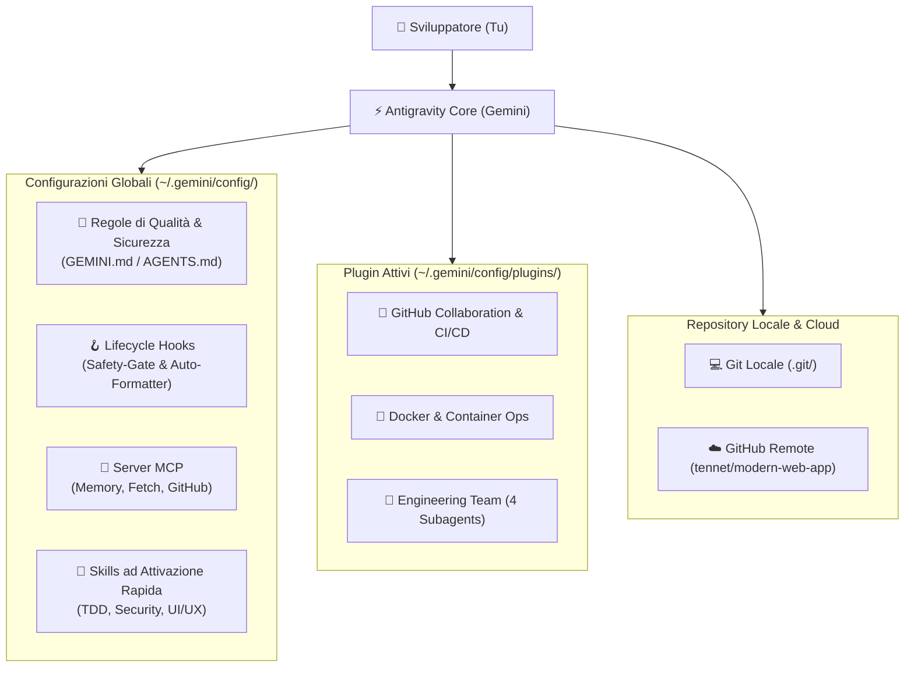

# 📘 Vademecum Antigravity: Guida Operativa Completa

> Questo vademecum raccoglie l'architettura completa, i componenti installati, i plugin, i server MCP, i subagent e le regole configurate nel tuo ambiente Antigravity, con istruzioni pratiche su **come e quando utilizzarli**.

---

## 🗺️ Mappa dell'Infrastruttura



---

## 1. Regole Globali di Codice (`GEMINI.md` / `AGENTS.md`)
* **Posizione**: `~/.gemini/config/GEMINI.md` e `~/.gemini/config/AGENTS.md`
* **Cosa fanno**: Stabiliscono gli standard non negoziabili che l'agente segue in **tutti i progetti**:
  1. **Strict Type Safety**: Obbligo di tipizzazione (niente `any` indiscriminati in TypeScript, type hints completi in Python).
  2. **Zero Secrets**: Divieto assoluto di hardcodare password, token o credenziali nei file di codice o nei log.
  3. **Sicurezza Difensiva**: Obbligo di query parametrizzate (anti-SQL injection) e sanificazione input.
  4. **Root Cause Analysis (RCA)**: Identificazione della causa radice prima di modificare il codice (stop ai fix casuali).
  5. **Modifiche a Basso Impatto**: Rispetto del codice funzionante e dei commenti esistenti.
* **Come e quando usarle**: Sono **sempre attive in background** in ogni conversazione. Non serve fare nulla: guidano l'agente a produrre codice robusto.

---

## 2. Server MCP (Model Context Protocol)
I server MCP estendono le capacità dell'agente collegandolo a strumenti esterni e memorie locali:

| Server MCP | Comando / Pacchetto | A cosa serve | Quando e come usarlo |
| :--- | :--- | :--- | :--- |
| **`memory`** | `@modelcontextprotocol/server-memory` | **Memoria a lungo termine (Knowledge Graph)**: memorizza concetti architetturali, preferenze di stile e decisioni di business persistenti tra le sessioni. | **Quando vuoi che l'agente ricordi qualcosa per sempre**.<br>*Esempio prompt*: *"Memorizza nella tua knowledge graph che nei nostri progetti usiamo sempre Tailwind v4 e non Bootstrap"*. |
| **`fetch`** | `@modelcontextprotocol/server-fetch` | **Web Fetcher ottimizzato**: scarica pagine web e documentazioni tecniche remote convertendole in Markdown pulito. | **Quando vuoi fargli leggere documentazione online**.<br>*Esempio prompt*: *"Usa fetch per consultare la documentazione a questo URL e spiegami l'API"*. |
| **`github-mcp`** | `@modelcontextprotocol/server-github` | **Integrazione GitHub API**: gestione remota di Issue, Pull Request, file remoti e rami. | **Per operare su GitHub dalla chat**.<br>*Esempio prompt*: *"Crea una nuova Issue su GitHub per tracciare il bug dell'autenticazione"*. |

---

## 3. Lifecycle Hooks (`hooks.json`)
* **Posizione**: `~/.gemini/config/hooks.json`
* **Cosa fanno**: Intercettano le azioni dell'agente prima e dopo l'esecuzione:
  1. **`safety-gate` (`PreToolUse` su `run_command`)**:
     * Esamina ogni comando da terminale prima che parta.
     * Blocca automaticamente comandi distruttivi (`rm -rf /`, `rm -rf ~`, `git push --force` su main, fork bomb).
  2. **`auto-formatter` (`PostToolUse` su `write_file|edit_file`)**:
     * Subito dopo che un file viene scritto o modificato, esegue in background il formattatore di codice (es. `ruff` per Python, `prettier` per JS/TS/JSON/Markdown se presenti).
* **Come e quando usarli**: Sono **completamente automatici e invisibili**. Proteggono il sistema e mantengono il codice formattato senza richiedere comandi manuali.

---

## 4. I Plugin Installati
I plugin raggruppano strumenti, regole e skill per domini specifici:

### 📦 [Plugin: GitHub Collaboration](customization://github)
* **Cartella**: `~/.gemini/config/plugins/github/`
* **Cosa include**: Regole di igiene Git, skill `github-workflow`, server MCP `github-mcp`.
* **Quando usarlo**:
  * Per creare branch puliti (`feature/nome-feature`).
  * Per preparare commit strutturati secondo lo standard **Conventional Commits** (`feat:`, `fix:`, `refactor:`, `docs:`).
  * Per revisionare le differenze prima di fare push.

### 📦 [Plugin: Docker & Container Ops](customization://docker)
* **Cartella**: `~/.gemini/config/plugins/docker/`
* **Cosa include**: Regole per Dockerfile sicuri (utente non-root, immagini Alpine/distroless, caching ottimale dei layer) e skill `docker-ops`.
* **Quando usarlo**:
  * Quando devi containerizzare un'applicazione.
  * Quando un container crasha e devi analizzare i log (`docker logs`).
  * Quando devi orchestrare database e servizi con `docker-compose.yml`.

### 📦 [Plugin: Engineering Team (Multi-Agent)](customization://engineering-team)
* **Cartella**: `~/.gemini/config/plugins/engineering-team/`
* **Cosa include**: 4 Subagent specializzati con compiti verticali dedicati.

---

## 5. La Squadra dei Subagent: Chi fa cosa e come chiamarli

Puoi delegare compiti specifici a ciascun subagent semplicemente nominandolo nel prompt:

```text
┌────────────────────────────────────────────────────────────────────────┐
│                        IL TUO TEAM MULTI-AGENTE                        │
├─────────────────────┬──────────────────────────────────────────────────┤
│ Subagent            │ Specializzazione & Ruolo                         │
├─────────────────────┼──────────────────────────────────────────────────┤
│ software-architect  │ Tech Lead & System Architect                     │
│ security-auditor    │ Adversarial Security Auditor & OWASP             │
│ qa-engineer         │ Test Automation & Bug Reproduction (TDD)         │
│ ui-ux-designer      │ Frontend Design Engineer (Bento Grid / Modern)   │
└─────────────────────┴──────────────────────────────────────────────────┘
```

### 🏛️ `software-architect`
* **Quando usarlo**: All'inizio di una nuova funzionalità complessa, quando devi progettare schemi di database, contratti API o scomporre requisiti ambigui.
* **Prompt di esempio**:
  > *"Chiedi a `software-architect` di progettare l'architettura per un sistema di notifiche in tempo reale con schema dei dati e diagramma Mermaid"*.

### 🛡️ `security-auditor`
* **Quando usarlo**: Prima di fare il merge di una feature, prima di rilasciare in produzione, o quando scrivi codice critico (autenticazione, pagamenti, query SQL, upload di file).
* **Prompt di esempio**:
  > *"Fai eseguire a `security-auditor` una scansione di sicurezza e un audit OWASP su tutti i file modificati prima del commit"*.

### 🧪 `qa-engineer`
* **Quando usarlo**: Quando trovi un bug e vuoi isolarlo prima di correggerlo, o quando vuoi scrivere una suite di test unitari completa (pytest, vitest, jest).
* **Prompt di esempio**:
  > *"Delega a `qa-engineer` la riproduzione di questo bug: scrivi prima il test che fallisce (Red), poi applichiamo il fix minimo per renderlo verde (Green)"*.

### 🎨 `ui-ux-designer`
* **Quando usarlo**: Quando devi creare landing page, dashboard, interfacce web, componenti React/HTML o template visivamente complessi e affascinanti.
* **Prompt di esempio**:
  > *"Chiedi a `ui-ux-designer` di creare una dashboard in stile Bento Grid con tema scuro profondo, card spotlight e indicatori di stato pulsanti"*.

---

## 6. Skills Globali ad Attivazione Rapida
Le skill contengono istruzioni passo-passo che Antigravity attiva dinamicamente su richiesta:

1. **[`modern-ui-ux-design`](file:///Users/manuele/.gemini/config/skills/modern-ui-ux-design/SKILL.md)**: Standard grafici ispirati a Linear, Stripe e Vercel (bento grid, illuminazione mesh, contrasto tipografico).
2. **[`automated-tdd-workflow`](file:///Users/manuele/.gemini/config/skills/automated-tdd-workflow/SKILL.md)**: Regole per lo sviluppo guidato dai test (Red-Green-Refactor).
3. **[`security-and-code-review`](file:///Users/manuele/.gemini/config/skills/security-and-code-review/SKILL.md)**: Checklist di audit per le Pull Request.

---

## 7. Prontuario Git Quotidiano (Cheat-Sheet)

Il tuo progetto è collegato a: **`https://github.com/tennet/modern-web-app`**

### Comandi Chiave da Usare nel Terminale o Chiedere ad Antigravity:

| Azione desiderata | Comando Git da terminale | Come chiederlo ad Antigravity in chat |
| :--- | :--- | :--- |
| **Vedere cosa è cambiato** | `git status` e `git diff` | *"Mostrami cosa abbiamo modificato e controlla la diff"* |
| **Lavorare su una nuova feature** | `git checkout -b feature/<nome>` | *"Crea un nuovo branch per sviluppare la feature X"* |
| **Salvare le modifiche (Commit)** | `git add . && git commit -m "..."` | *"Prepara un commit convenzionale per le modifiche fatte"* |
| **Inviare le modifiche online** | `git push` | *"Invia le modifiche su GitHub"* |
| **Tornare al branch principale** | `git checkout main && git pull` | *"Torna su main e sincronizza il codice"* |

---

## 8. I Comandi Speciali (Slash Commands) di Antigravity

*   **/plugin**: Mostra lo stato di tutti i plugin installati e i link rapidi alle loro pagine di configurazione.
*   **/grill-me**: Chiede all'agente di farti un'intervista tecnica con domande a risposta multipla prima di iniziare un lavoro complesso, per chiarire ogni dettaglio.
*   **/teamwork-preview**: Avvia una modalità di lavoro cooperativo con subagent multipli che lavorano in parallelo.
*   **/boost**: Attiva la modalità di ragionamento profondo con pianificazione strategica avanzata.
*   **/goal**: Esegue un task a lungo termine ad oltranza finché non è completato e verificato.

---

*Documento creato e sincronizzato automaticamente su Git & GitHub nel repository tennet/modern-web-app.*
