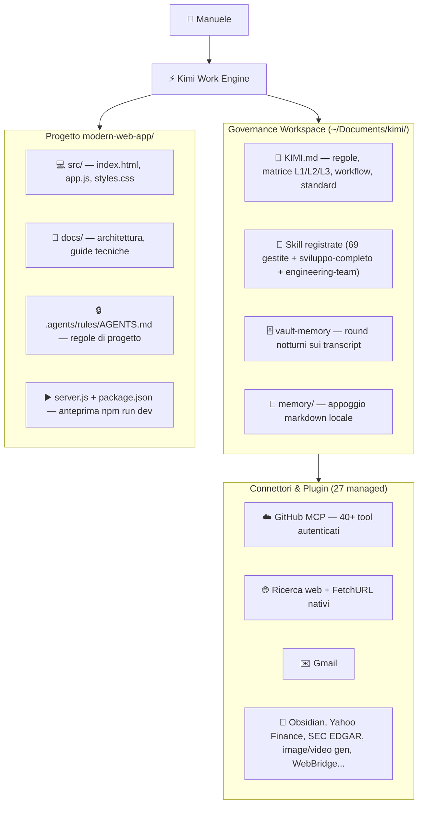
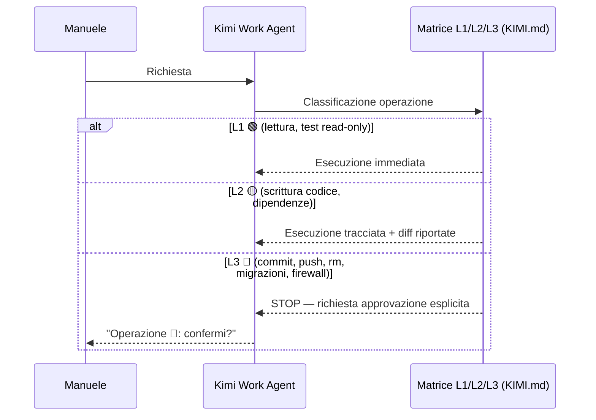

# 📘 Guida Tecnica Dettagliata: Architettura & Ecosistema Kimi Work

> **Versione**: 1.1.0 — Centro di comando Kimi Work post-migrazione da Antigravity
> **Repository di riferimento**: [tennet/modern-web-app](https://github.com/tennet/modern-web-app)
> **Ambiente Operativo**: macOS | Kimi Desktop Work | Node.js | Python 3 | Git
> **Fonte di verità governance**: `KIMI.md` (workspace root — **non incluso in questo repository**)
> **Guida semplice**: [VADEMECUM-KIMI-WORK.md](../VADEMECUM-KIMI-WORK.md)

---

## 1. Mappa Architetturale Completa

L'ambiente separa la **governance del workspace** (regole, skill, memoria persistente) dalla **specificità dei singoli progetti** (codice, docs, regole locali `.agents/`).



---

## 2. Struttura Directory e Asset di Sistema

```text
~/Documents/kimi/                          # WORKSPACE (non versionato su Git)
├── KIMI.md                                # Governance globale (fuori repo, vedi nota §1)
├── config-backup-<data>.json              # Backup config pre-migrazione (non versionato)
├── memory/                                # Appoggio memoria locale
├── modern-web-app/                        # PROGETTO (replica di tennet/modern-web-app)
│   ├── .agents/rules/AGENTS.md            # Regole vincolanti di progetto
│   ├── docs/
│   │   ├── architettura.md                # Specs tecniche web app (orig. Antigravity)
│   │   ├── GUIDA_TECNICA_DETTAGLIATA.md   # Guida originale Antigravity
│   │   └── GUIDA_TECNICA-KIMI-WORK.md     # Questa guida
│   ├── src/                               # index.html, app.js, styles.css
│   ├── server.js                          # Static server zero-dep per anteprima Kimi
│   ├── package.json                       # npm run dev → node server.js
│   ├── VADEMECUM.md                       # Guida semplice originale Antigravity
│   ├── VADEMECUM-KIMI-WORK.md             # Guida semplice Kimi Work
│   └── README.md, .gitignore
└── [altri progetti]

# ASSET DI SISTEMA KIMI DESKTOP (fuori workspace, percorsi intenzionalmente generici)
~/Library/Application Support/kimi-desktop/
└── daimon/                                # config.json, skills/, runtime/.../plugins/managed/
```

> **Nota**: i percorsi di sistema di Kimi Desktop sono riportati in forma generica di proposito;
> quelli operativi esatti sono nel backup del config conservato nel workspace (non versionato).

---

## 3. Matrice dei 7 Ruoli Specializzati (skill `engineering-team`)

| Ruolo | Focus | Output atteso | Confine di responsabilità |
| :--- | :--- | :--- | :--- |
| 🎯 `project-orchestrator` | Decomposizione, dipendenze, verifica finale | Piano a fasi, assegnazione compiti | Non scrive codice: coordina |
| 🏛️ `software-architect` | Design moduli, contratti, trade-off | Specs, diagrammi, scelte strutturali | Non implementa: decide come |
| 🎨 `ui-ux-designer` | Bento dark, micro-interazioni, responsive | HTML/CSS/Tailwind ad alto impatto | Non tocca logica applicativa |
| 🧪 `qa-engineer` | TDD, isolamento bug, casi limite | Test Red→Green, diagnosi difetti | Non tocca integrazione cross-modulo |
| 🔌 `integration-tester` | Flussi dati end-to-end, API, HTTP | Verifica cooperazione componenti | Non scrive test unitari |
| 🛡️ `security-auditor` | OWASP, secret leak, threat model | Report vulnerabilità + fix, **diritto di veto** | Non approva la chiusura se trova criticità |
| 📝 `documentation-engineer` | Docs-as-Code, README, changelog | Doc aggiornate, veritiere | Documenta solo ciò che è verificato |

**Modalità**: default = emulazione dall'agente principale (zero overhead). Delega a subagent reale solo su richiesta esplicita dell'utente.

---

## 4. Architettura dei Connettori (MCP via Plugin)

### A. GitHub (plugin `github`) — ✅ attivo, autenticato
- Tool MCP esposti in sessione: issue/PR read-write, branch, commit, file contents, code search, releases, secret scanning, Copilot review.
- Uso tipico: sincronizzazione repo, ricerca codice, gestione PR.

### B. Ricerca web + FetchURL — ✅ nativi (non serve MCP esterno)
- `WebSearch`: ricerca semantica con filtri data/sito e rating fonti.
- `FetchURL`: lettura contenuto pagina in markdown ripulito.
- Equivalente funzionale del MCP `fetch` Antigravity, con ricerca inclusa.

### C. vault-memory — ✅ abilitato il 2026-10-22
- Meccanismo: round su target transcript (automatici nella manutenzione giornaliera + manuale su richiesta).
- Pipeline verificata: `rounds=1 ok=1 decorators=ok lint=0`.
- Stato persistito in `config.json` del runtime Kimi Desktop: tool rimosso da `systemTools.disabled` (resta disabilitato solo `skill-summary`); feature flags memoria attivi.
- Il percorso esatto del config è nel backup conservato nel workspace (non versionato).

### D. Altri connettori installati (27 plugin managed)
gmail, obsidian, kimi-webbridge (browser reale utente), kimi-cu (computer use macOS), yahoo_finance, sec_edgar, imf, world_bank_open_data, igo_open_data, scholar, pubchem, ncbi_blast, materials_project, image_generation, video_generation, audio_generation, model3d_generation, openart-agent, canva-global, cloudflare, kimi-excel, kimi-pdf, kimi-word, kimix-website-publish, mobile-app-building, musepool.

---

## 5. Meccanismo di Sicurezza: Matrice di Autonomia (equivalente degli hook Antigravity)

In Antigravity gli hook `safety-gate`/`auto-formatter` operavano a livello motore. In Kimi Work l'equivalente è **normativo**: la matrice è dichiarata in `KIMI.md` e applicata dall'agente ad ogni turno; il client mostra inoltre una UI permessi per tool sensibili.



| Pattern | Antigravity | Kimi Work |
| :--- | :--- | :--- |
| Blocco comandi distruttivi | Hook `safety-gate` (tecnico) | Matrice L3 + UI permessi (normativo + client) |
| Formattazione automatica | Hook `auto-formatter` | Non automatico: su richiesta |
| Verifica pre-push | Obbligo di approvazione | Identico (L3) |

**Limite onesto**: il blocco L3 dipende dalla conformità dell'agente, non da un intercettore di sistema. Vincolo rispettato durante la migrazione (nessun git eseguito).

---

## 6. Il Workflow `sviluppo-completo` (skill registrata)

1. **Fase 1 — Analisi**: config del progetto, stato Git, test runner disponibili.
2. **Fase 2 — Pianificazione**: scomposizione in attività, file toccati, livello di autonomia.
3. **Fase 3 — Implementazione**: modifiche minime circoscritte, zero secret, rispetto standard design.
4. **Fase 4 — Verifica**: test reali (mai presunti), integrazione E2E, scan OWASP base.
5. **Fase 5 — Chiusura**: Docs-as-Code, report verificabile, **stop vincolante prima di commit/push**.

Il ruolo security-auditor ha diritto di veto sulla Fase 5.

---

## 7. Matrice di Autonomia Operativa

| Livello | Colore | Operazioni ammesse | Requisiti |
| :--- | :--- | :--- | :--- |
| **L1** | 🟢 | Lettura file, navigazione, test read-only, report | Immediate, autonome |
| **L2** | 🟡 | Scrittura codice, installazione dipendenze standard | Tracciate, con diff visibili |
| **L3** | 🔴 | Cancellazioni, distruttivi, credenziali, migrazioni DB, commit/push, deploy, firewall | Approvazione umana esplicita obbligatoria |

---

## 8. Meccanismo di Anteprima Web

- `server.js`: HTTP server Node zero-dipendenze, serve `src/`, accetta `--host`/`--port` (anche forma `--port=NNNN`), gestore pulito di `EADDRINUSE`.
- Blocco path traversal con `path.relative()` (robusto anche verso directory sibling con prefisso `src` e non solo `startsWith`), verificato: **403** su `/../` raw e codificato, 404 su doppia codifica.
- `package.json`: `npm run dev` → default `127.0.0.1:7100`.
- Kimi Work gestisce il ciclo di vita del server di preview: avvio su apertura card, nessun processo orfano.

---

## 9. Protocollo di Rollback & Ripristino

> I percorsi esatti del runtime Kimi Desktop sono nel backup del config conservato nel workspace (non versionato).

**Disabilitare/riabilitare vault-memory**: nel `config.json` del runtime Kimi Desktop, chiave
`runtime.systemTools.disabled` → aggiungere/rimuovere `"vault-memory"`.

**Ripristino config pre-migrazione**: copiare il backup del config (creato prima della
modifica, conservato nel workspace non versionato) sopra il `config.json` del runtime.

⚠️ Ripristinare il config richiede riavvio di Kimi Desktop per avere effetto. Con più backup
presenti, specificare il file esatto invece di un wildcard nel comando di copia. Il backup non
è versionato: valutare una copia fuori dalla macchina per i backup futuri.

---

## 10. Differenze residue rispetto ad Antigravity

| Voce | Stato |
| :--- | :--- |
| Subagent paralleli on-demand | ⚠️ Solo su richiesta esplicita |
| Hook formattazione automatica | ❌ Non presente (su richiesta) |
| Plugin Docker | ❌ Non installato |
| Knowledge graph MCP memory | ✅ Sostituito da vault-memory |
| Tutto il resto (team, workflow, sicurezza policy, design system, Git standards) | ✅ Operativo |
