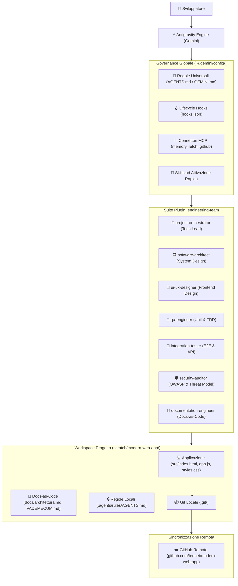
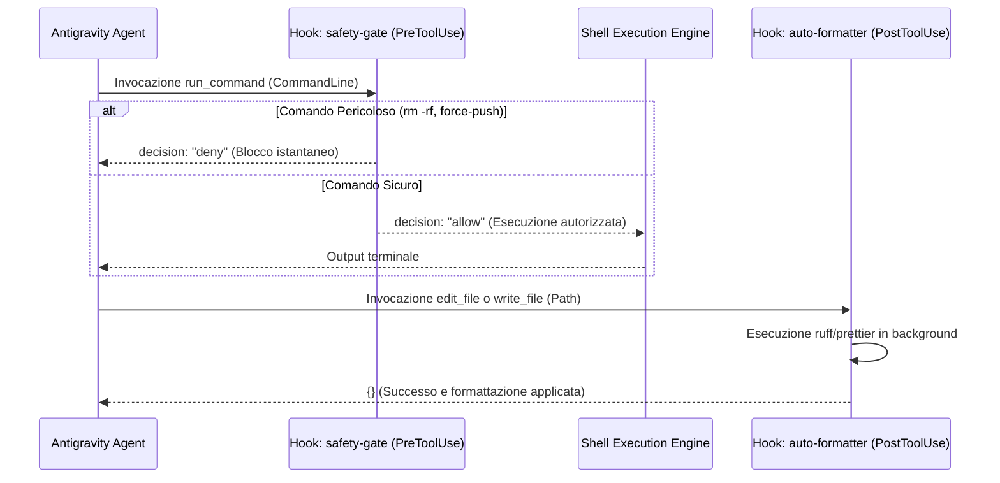

# 📘 Guida Tecnica Dettagliata: Architettura & Ecosistema Antigravity

> 📦 **Documento storico** — descrive l'ambiente Antigravity originale. Versione corrente per Kimi Work: [kimi/GUIDA_TECNICA-KIMI-WORK.md](../kimi/GUIDA_TECNICA-KIMI-WORK.md).

> **Versione**: 2.0.0 — Architettura a Centro di Comando Universale  
> **Repository di riferimento**: [tennet/modern-web-app](https://github.com/tennet/modern-web-app)  
> **Ambiente Operativo**: macOS | Node.js v26.8.1 | Python 3.15.0 | Git 2.55.0

---

## 1. Mappa Architetturale Completa

L'ambiente è strutturato per separare rigorosamente la **governance globale** (regole, hook, subagent e memorie persistenti) dalla **specificità del singolo progetto** (codice, dipendenze, test e documentazione locale).



---

## 2. Directory Structure e Asset di Sistema

```text
~/.gemini/config/
├── AGENTS.md / GEMINI.md          # Standard globale di ingegneria e condotta
├── mcp_config.json                # Configurazione server MCP globali (memory, fetch)
├── hooks.json                     # Event Lifecycle Hooks (PreToolUse e PostToolUse)
├── .backup_snapshot_v1/           # Snapshot di sicurezza delle configurazioni
├── skills/                        # Skills globali on-demand
│   ├── sviluppo-completo/SKILL.md # Workflow a 5 fasi
│   ├── modern-ui-ux-design/SKILL.md
│   ├── automated-tdd-workflow/SKILL.md
│   └── security-and-code-review/SKILL.md
└── plugins/                       # Bundle e plugin installati
    ├── engineering-team/          # Plugin con la squadra dei 7 subagent
    │   ├── plugin.json (v2.0.0)
    │   └── agents/*.md            # File di definizione dei singoli agenti
    ├── github/                    # Plugin GitHub con MCP e skill di workflow
    └── docker/                    # Plugin Docker con best-practices container
```

---

## 3. Matrice dei 7 Subagent Specializzati

Ogni subagent possiede un prompt di sistema dedicato che ne delimita responsabilità e perimetro d'azione, evitando sovrapposizioni e duplicazioni di calcolo:

| Subagent | File di Definizione | Input Tipico | Output Prodotto | Responsabilità Primaria |
| :--- | :--- | :--- | :--- | :--- |
| **`project-orchestrator`** | `agents/project-orchestrator.md` | Requisito utente ad alto livello | Piano di lavoro a fasi e assegnazione compiti | Decomposizione del lavoro, coordinamento parallelo, verifica finale prima della chiusura. |
| **`software-architect`** | `agents/software-architect.md` | Requisito funzionale complesso | Specifiche contrattuali e diagrammi Mermaid | Design dei moduli, separazione di responsabilità, schema dati e trade-off tecnici. |
| **`ui-ux-designer`** | `agents/ui-ux-designer.md` | Wireframe o bozza interfaccia | Codice HTML/Tailwind/CSS ad alto impatto | Layout Bento Grid, illuminazione mesh, contrasto tipografico e micro-interazioni. |
| **`qa-engineer`** | `agents/qa-engineer.md` | Funzione da testare o bug | Test fallimentare (Red) e test suite | Metodologia TDD rigorosa, test unitari, isolamento dei difetti e casi limite. |
| **`integration-tester`** | `agents/integration-tester.md` | Flusso dati o endpoint API | Test di cooperazione tra moduli | Verifica passaggio dati frontend-backend-DB, robustezza di rete e codici HTTP. |
| **`security-auditor`** | `agents/security-auditor.md` | Diff di codice prima del commit | Report di vulnerabilità con fix | Scansione OWASP (injection, traversal, XSS), privilege escalation e secret leaks. |
| **`documentation-engineer`** | `agents/documentation-engineer.md` | Modifiche verificate | File `.md` aggiornati e Changelog | Manutenzione Docs-as-Code, documentazione veritiera e priva di allucinazioni. |

---

## 4. Architettura dei Server MCP (Model Context Protocol)

I server MCP permettono all'agente di estendere i suoi tool oltre il semplice testo:

### A. `@modelcontextprotocol/server-memory` (Knowledge Graph)
* **Trasporto**: `Stdio` tramite `npx -y @modelcontextprotocol/server-memory`.
* **Meccanismo**: Memorizza nodi (*Entities*), attributi (*Observations*) e archi (*Relations*).
* **Dati attualmente persistiti**:
  - `User_Preferences`: preferenza lingua italiana, estetica dark Bento Grid, approvazione esplicita per commit/push.
  - `Antigravity_Environment`: specifiche hardware, runtime (Node/Python/Git), percorsi di configurazione e backup.
  - `Engineering_Team_Plugin`: composizione della squadra a 7 subagent.
  - `Sviluppo_Completo_Workflow`: le 5 fasi e la politica di autonomia.
  - `GitHub_Integration`: profilo utente `tennet`, repo e standard Conventional Commits.

### B. `@modelcontextprotocol/server-fetch` (Web Ingestion)
* **Trasporto**: `Stdio` tramite `npx -y @modelcontextprotocol/server-fetch`.
* **Meccanismo**: Scarica pagine web via HTTP, estrae il contenuto semantico ripulendolo da script/pubblicità e produce Markdown ottimizzato per la finestra di contesto.

### C. `@modelcontextprotocol/server-github` (GitHub API Gateway)
* **Trasporto**: `Stdio` con autenticazione via token personale `GITHUB_TOKEN`.
* **Meccanismo**: Gestione remota di Issue, Pull Request, fork, rami e controlli CI/CD.

---

## 5. Meccanismo dei Lifecycle Hooks (`hooks.json`)

Gli hook operano come middleware sincroni nel loop di esecuzione dell'agente:



1. **`safety-gate` (`PreToolUse`)**:
   - Riceve su `stdin` il payload JSON della chiamata tool.
   - Analizza la riga di comando con espressioni regolari per pattern critici:
     `rm\s+-[rfRF]{2,}\s+(/|~|\$HOME|\.\.)`, `git\s+push\s+.*--force.*(main|master)`, fork bomb.
   - Restituisce `{"decision": "deny", "reason": "..."}` impedendo l'esecuzione prima che il comando tocchi il sistema operativo.
2. **`auto-formatter` (`PostToolUse`)**:
   - Riceve su `stdin` il percorso del file appena scritto.
   - Se il file è `.py`, lancia `ruff format` se disponibile.
   - Se il file è `.js`, `.ts` o `.json`, lancia `prettier --write` se disponibile.
   - Restituisce sempre `{}` su `stdout` garantendo un fail-safe non bloccante.

---

## 6. Il Workflow `sviluppo-completo` (Protocollo a 5 Fasi)

Il workflow codificato in [`skills/sviluppo-completo/SKILL.md`](file:///Users/manuele/.gemini/config/skills/sviluppo-completo/SKILL.md) si articola in:

1. **Fase 1 — Analisi Automatica**:
   - Ispezione file di configurazione (`package.json`, `pyproject.toml`).
   - Controllo stato Git (`git status`, branch corrente).
   - Verifica test runner disponibili e funzionanti.
2. **Fase 2 — Pianificazione & Delega**:
   - `project-orchestrator` valuta la complessità.
   - Scomposizione in attività indipendenti. Creazione di branch `feature/<nome>` o worktree se paralleli.
3. **Fase 3 — Implementazione a Modifiche Minime**:
   - Modifica circoscritta dei file interessati.
   - Rispetto di commenti e backward compatibility. Nessun secret in chiaro.
4. **Fase 4 — Verifica Indipendente**:
   - Esecuzione test unitari (`qa-engineer`).
   - Verifica di integrazione end-to-end (`integration-tester`).
   - Scansione vulnerabilità OWASP (`security-auditor`).
5. **Fase 5 — Chiusura Controllata**:
   - Aggiornamento documentazione (`documentation-engineer`).
   - Generazione del report finale verificabile.
   - **Richiesta esplicita di autorizzazione prima di qualsiasi `git commit` o `git push`**.

---

## 7. Matrice di Autonomia Operativa

| Livello | Colore | Operazioni Ammesse | Requisiti di Sicurezza |
| :--- | :--- | :--- | :--- |
| **Livello 1** | 🟢 **Verde** | Lettura file, navigazione cartelle, esecuzione test locali di sola lettura, generazione report. | Esecuzione immediata e autonoma nei limiti della sandbox. |
| **Livello 2** | 🟡 **Giallo** | Scrittura e modifica file di codice, installazione dipendenze standard, coordinamento subagent. | Esecuzione tracciata con presentazione visiva delle diff all'utente. |
| **Livello 3** | 🔴 **Rosso** | Cancellazione file, comandi distruttivi, credenziali, migrazioni DB, commit, push su GitHub e deploy. | **Stop vincolante**: richiede approvazione umana esplicita. |

---

## 8. Protocollo di Rollback & Ripristino di Emergenza

In caso di anomalia o configurazione corrotta:
*   È disponibile lo snapshot pulito in:
    📁 [`/Users/manuele/.gemini/antigravity/scratch/backup_snapshot_v1/`](file:///Users/manuele/.gemini/antigravity/scratch/backup_snapshot_v1/)
*   Per ripristinare istantaneamente:
    ```bash
    cp /Users/manuele/.gemini/antigravity/scratch/backup_snapshot_v1/mcp_config.json ~/.gemini/config/
    cp /Users/manuele/.gemini/antigravity/scratch/backup_snapshot_v1/hooks.json ~/.gemini/config/
    cp /Users/manuele/.gemini/antigravity/scratch/backup_snapshot_v1/AGENTS.md ~/.gemini/config/
    cp /Users/manuele/.gemini/antigravity/scratch/backup_snapshot_v1/GEMINI.md ~/.gemini/config/
    ```
